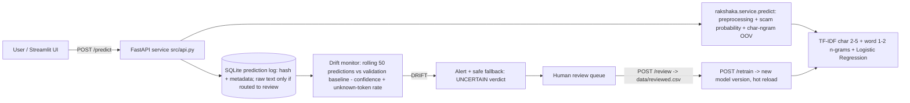

# Rakshaka AI

**Problem statement:** An ML service that flags scam SMS and WhatsApp messages in Sinhala, Tamil and Singlish, aimed at first-time mobile-banking users and pensioners in Sri Lanka. It detects and responds when new scam tactics (such as fake SL-UDI digital ID verification) make the model drift.

Rakshaka AI classifies messages in English, Sinhala, Singlish, Tamil and Tanglish (Sinhala and Tamil written in
Latin letters). A drift monitor notices when incoming messages stop looking like the training data, switches to a
safe "uncertain" verdict, and routes those messages to human review and one-click retraining.

## Who it protects
First-time mobile-banking users, pensioners and welfare recipients who receive scam SMS and WhatsApp messages in
Sinhala, Tamil or Singlish. These are the groups the Central Bank says scams hit hardest. They include 727,092
government pensioners and 1,251,522 Aswesuma beneficiary families, within a population of 13.9 million internet
users. Reach, harm and the path to a pilot are in [IMPACT.md](IMPACT.md).

## Architecture




### Repository layout
| Path | What it is |
|---|---|
| `src/make_data.py` | Synthetic multilingual data generator: train / val / test / shifted, split by template |
| `src/train.py`, `src/evaluate.py` | Training (+ drift baselines from `val.csv`) and held-out evaluation, writes `reports/metrics.json` |
| `src/api.py`, `src/features.py` | FastAPI service: prediction, logging, drift monitor, review queue, retrain trigger |
| `app/dashboard.py` | Streamlit UI: check a message, monitoring and drift demo, human review + retrain |
| `rakshaka/` | Shared library: text cleaning, label handling, preprocessing, classifier, group splits, per-language metrics, char-ngram OOV signal, `predict()` |
| `scripts/` | Optional pipeline for the public English SMS datasets and human-verified translations (see below) |
| `tests/` | Unit tests (`python -m unittest discover -s tests`) |

## How to run
```bash
docker compose up --build                      # API: http://localhost:8000/docs   UI: http://localhost:8501
API_PORT=8001 docker compose up --build        # if port 8000 is already taken (UI_PORT works the same way)
ADMIN_TOKEN=choose-a-secret docker compose up --build   # enables review, history, /retrain and /rollback
```
or, without Docker, one command (macOS / Linux):
```bash
./run.sh                               # API: http://127.0.0.1:8000/docs   UI: http://localhost:8501
API_PORT=8001 UI_PORT=8502 ./run.sh    # if 8000 or 8501 is already taken
RETRAIN=1 ./run.sh                     # regenerate data and retrain first
```
`run.sh` creates `.venv` on Python 3.12 or newer if it is missing (a plain `python` may be older and fail), installs
`requirements.txt` when it changes, and checks that both ports are free. It generates the data and trains the model
only if they are missing, so an existing model and its review history are kept. Then it starts the API, waits for
`/health`, and starts the dashboard. Ctrl+C stops both.

By hand, the same steps are:
```bash
python3.12 -m venv .venv && source .venv/bin/activate     # any Python 3.12+
pip install -r requirements.txt
python src/make_data.py && (cd src && python train.py && python evaluate.py)   # first run: data + model
cd src && uvicorn api:app --port 8000                     # terminal 1
streamlit run app/dashboard.py                            # terminal 2: activate .venv, from the repo root
```
On Windows the dashboard calls the API on `127.0.0.1`, not `localhost`. Using `localhost` adds about 2 s per
request because of the IPv6 fallback.

**Public API** (no token): `GET /health`, and `POST /predict` (`{"text": "...", "language": "sinhala"}`; `language`
is one of `english`, `sinhala`, `singlish`, `tamil`, `tanglish`, `unknown`). `/predict` is rate-limited per client
(`PREDICT_PER_MINUTE`, default 120; then 429), so one caller cannot flood the live drift window. It returns the
verdict and scores, but no drift statistics.

**Admin API** (header `X-Admin-Token: <ADMIN_TOKEN>`; 401 without a valid token, and 503 if the API was started
without `ADMIN_TOKEN`, so it is off rather than open):

| Endpoint | Purpose |
|---|---|
| `GET /monitor?mode=live\|simulation` | Drift status, window means, baseline and thresholds |
| `GET /predictions?source=live\|simulation\|all` | Prediction metadata for charts (never message text) |
| `GET /alerts` | DRIFT, DRIFT_SIMULATION, SIMULATION, RETRAIN_DEPLOYED / REJECTED and ROLLBACK history |
| `POST /simulate` `{"dataset": "test"\|"shifted", "n": 1-100}` | Drift demo on the server (see below) |
| `POST /simulate/reset` | Clear the simulation window |
| `GET /review_queue`, `POST /review`, `DELETE /review_queue/{rowid}` | Human review: read, label, discard |
| `POST /retrain`, `POST /rollback` | Gated retrain; restore the previous model |

**Drift simulation is separate from live traffic.** `POST /simulate` scores a bounded sample (at most 100) of a
fixed synthetic dataset on the server, in its **own drift window**, with `source=simulation` in the log. Demo runs
therefore never change live drift metrics, and the public `/predict` is never used for simulation. Runs must be at
least `SIM_MIN_INTERVAL` seconds apart (default 3; then 429), and only one runs at a time. Each run is audited as a
`SIMULATION` alert; a simulated drift episode is logged as `DRIFT_SIMULATION`, never as a live `DRIFT`. Uncertain
simulated checks still enter the review queue, so the review → retrain demo works.

`./run.sh` generates a token when none is set and prints it.

## Streamlit dashboard

There is **one UI**: `app/dashboard.py`. It reads all its data from the FastAPI service (`src/api.py`). `./run.sh`
starts both (see [How to run](#how-to-run)). To start them by hand, inside the Python 3.12+ `.venv`:

```bash
cd src && uvicorn api:app --port 8000          # terminal 1: API (needs a trained model in models/)
streamlit run app/dashboard.py                 # terminal 2, from the repo root: UI on http://localhost:8501
```

If the API runs on another port, set `API_URL`, for example
`API_URL=http://127.0.0.1:8001 streamlit run app/dashboard.py`.

Two sides:

- **Public: Check a message** (`/`, no login). Paste a message and choose its language. The result shows the verdict
  (SCAM, LIKELY SAFE, or UNCERTAIN - sent for review), the fraud score, the share of unseen words and of unfamiliar
  character patterns, and safety guidance.
- **Admin desk** (`/login`, then `/admin`). Sign in with the API's admin token. The API checks it, the dashboard
  stores no secret of its own, and the token is kept only for that browser session. Four tabs:
  - **Monitoring:** the live drift status, live-window vs baseline vs alert-line bars (unknown-token rate and mean
    confidence), a line chart of every real check, language and result bars, and the alert log.
  - **Drift simulation:** "Send normal wording" / "Send new scam tactics" call `POST /simulate`. The tab shows the
    simulation window's own status and charts, and has a reset button. Live monitoring is unaffected.
  - **Human review:** each queued message starts with **no label**. The reviewer must choose "scam" or
    "legitimate", and unlabelled rows are not saved (pre-filled guesses had caused six wrong labels). **Save labels
    and retrain** shows whether the candidate passed the regression gate, with a live vs candidate table. **Discard
    unlabelled rows** erases their text.
  - **Models:** the live version, training size, human labels used, and **Roll back** to the previous model.

## Data sources
| Source | Licence / method | Used for |
|---|---|---|
| `src/make_data.py` templates | Synthetic, hand-written by the team with AI assistance (Claude). All names, numbers and links are fake placeholders (`DemoBank`, `07X-XXXXXXX`, `*.example`) | train / val / test / shifted |
| `data/extra_train.csv` | Synthetic, 188 hand-curated messages written with Claude Code (Claude Opus 5.5), not yet checked by native speakers: Sinhala, Tamil, Singlish and Tanglish, about 23-24 scam and 23-24 legitimate per language. Fake placeholders only (`DemoBank`, `TestPay`, `07X-XXXXXXX`, `*.example`). The wording avoids the held-out test/val templates and their translations, and the shifted-set tactics | train |
| `data/extra_test.csv` | Synthetic, 65 messages written with Claude Code (Claude Opus 5.5), separately from the templates and `extra_train.csv`, not yet checked by native speakers: Sinhala 15 legitimate + 10 scam, Tanglish 20 + 20. Fake placeholders only | independent final test (never trained on, not in the retrain gate) |
| `data/reviewed.csv` (runtime) | Labels entered by human reviewers in the dashboard | retraining |
| [UCI SMS Spam Collection](https://archive.ics.uci.edu/dataset/228/sms+spam+collection) (Almeida & Hidalgo, 2011, DOI 10.24432/C5CC84) and [SMS Phishing Dataset for Machine Learning and Pattern Recognition](https://data.mendeley.com/datasets/f45bkkt8pr/1) (Mishra & Soni, 2022, DOI 10.17632/f45bkkt8pr.1) (optional, not included in the repo) | Both CC BY 4.0 | `scripts/` pipeline only |

No real personal data, phone numbers, NIC numbers or screenshots are used, in line with the PDPA No. 9 of 2022.
Demo messages that mention real programmes or services (Aswesuma, SL-UDI, eZ Cash) are clearly labelled synthetic examples.

The data is split **by template**: every message generated from one template lands in exactly one split,
so test scores measure generalisation to unseen wording instead of memorised templates. The split is
stratified by (label, language) with seed 42.
- **Train** (`data/train.csv`): 1,365 rows: 1,177 from 46 templates plus the 188 messages in `data/extra_train.csv`.
- **Validation** (`data/val.csv`): 276 rows from 10 unseen templates. Used only to measure the drift-monitor baseline.
- **Held-out test set** (`data/test.csv`): 264 rows from 12 unseen templates, covering the same tactics as training.
- **Shifted set** (`data/shifted.csv`): 152 rows from 15 templates with **new tactics**: SL-UDI digital ID / QR
  scams, biometric "re-verification" fees, USDT/AI crypto groups, "new number" impersonation, voice-note lures and
  heavier code-mixing.

## Evaluation (model v1, from `reports/metrics.json`)
| Set | Rows | Balanced acc. | Macro F1 | F1 (scam) | Mean confidence | Unknown-token rate |
|---|---|---|---|---|---|---|
| validation baseline | 276 | | | | 0.828 | 18.7% |
| **test** (unseen templates) | 264 | 0.926 | 0.946 | 0.972 | 0.823 | 12.3% |
| shifted (new tactics) | 152 | 1.000 | 1.000 | 1.000 | 0.799 | **38.1%** |
| **independent** (Sinhala + Tanglish, `data/extra_test.csv`) | 65 | 0.983 | 0.984 | 0.983 | | |

Test confusion matrix (rows = actual legitimate/scam, columns = predicted): `[[63, 11], [0, 190]]`.
No scam was missed. 11 legitimate messages were flagged as scam.

Per language on test (balanced accuracy): English 1.00, Singlish 1.00, Tamil 1.00, **Sinhala 0.63**.
**All 11 false alarms are copies of one held-out Sinhala template**, a water-bill notice ("pay via the official
app") whose payment wording overlaps with Sinhala scams. The template test set has only one Sinhala legitimate
template, so this one pattern sets the whole Sinhala score.

**Independent test set** (`data/extra_test.csv`, 65 messages): 15 legitimate and 10 scam Sinhala messages, and
20 legitimate and 20 scam Tanglish messages. They were written separately from the templates and from
`extra_train.csv`, before any further tuning, and are never used for training or retraining decisions.
- **Sinhala 1.00:** all 15 legitimate (bills, appointments, notices, family messages) and all 10 scams correct.
- **Tanglish 0.97:** the first Tanglish test. The one miss is a "boss asks for a gift-card code" impersonation with
  no link or number (scam probability 0.47). Its confidence is under 0.60, so the API routes it to human review
  instead of calling it safe.
- The closest match between this set and any training text is 0.73 (two bill reminders), measured with
  `difflib`.

Per-language confusion matrices (rows = actual legitimate / scam, columns = predicted legitimate / scam):

| Set | Language | Messages | Confusion matrix | Balanced acc. |
|---|---|---|---|---|
| test | English | 127 | `[[41, 0], [0, 86]]` | 1.00 |
| test | Singlish | 39 | `[[6, 0], [0, 33]]` | 1.00 |
| test | Sinhala | 58 | `[[4, 11], [0, 43]]` | 0.63 |
| test | Tamil | 40 | `[[12, 0], [0, 28]]` | 1.00 |
| independent | Sinhala | 25 | `[[15, 0], [0, 10]]` | 1.00 |
| independent | Tanglish | 40 | `[[20, 0], [1, 19]]` | 0.97 |

We did **not** add bill-style Sinhala messages to training to fix the 0.63: that would tune the model to the test
set. The next step is native-speaker-written legitimate Sinhala data. All of these scores come from synthetic
messages written by the team with AI assistance, and are not a claim about real-world traffic.

## Monitoring and drift response
- **Prediction logging:** every prediction goes to `logs/predictions.db` with a timestamp, text hash, language,
  label, confidence, unknown-token rate, char-ngram OOV ratio, model version and routing. Operational logs go to
  `logs/service.log`. **Privacy:** raw message text is stored **only** for messages routed to human review,
  because a reviewer has to read them. Auto-handled messages keep only a hash.
- **Drift signal:** a rolling window of the last 50 predictions (judged after 20) is compared with baselines
  measured on the validation templates:
  - mean confidence drops by more than 0.10, or
  - the unknown-token rate (share of words never seen in training) rises more than 12 points. In 1,000 random
    50-message batches, normal test traffic never rose more than -1 point, and shifted traffic always rose at
    least +13.5 points.
- **Response:** a `DRIFT` alert is logged once per episode (`/alerts`, dashboard banner). Verdicts switch to
  "UNCERTAIN - be careful, sent for review", a safe fallback that never says "safe". Messages go to the
  **human review queue**, where a reviewer labels them (`POST /review` → `data/reviewed.csv`) and triggers
  **`/retrain`**. Individual messages also go to review when
  confidence is below 0.60 (about 3% of normal traffic) or when 50% or more of their words are unseen.

- **Safe retraining (regression gate):** `/retrain` first trains a *candidate* in `models/candidate/`. It scores
  the candidate and the live model on a fixed regression set, `val.csv` + `test.csv`, which is never trained on.
  Any message a reviewer has labelled is left out of that set. The candidate replaces the live model only if
  balanced accuracy, scam recall and legitimate recall each drop by no more than 0.01. Otherwise the live model
  stays, and a `RETRAIN_REJECTED` alert names the reason. The independent set (`extra_test.csv`) is kept out of
  this gate on purpose.
  - Measured through the API: review labels that ticked every legitimate new-tactic message as scam were
    **rejected** ("legitimate recall fell from 0.948 to 0.929"), and v1 stayed live. Correct labels passed (0.968
    to 0.973), and v2 was deployed.
  - The gate only catches damage that shows up on its regression set: in an offline test it caught 2 of 3
    simulated bad-label batches. Reviewers still have to set every label deliberately.

- **Rollback:** a deployed retrain keeps the outgoing model in `models/previous/`. `POST /rollback` swaps it back
  (and again to swap forward), with a `ROLLBACK` alert. Candidate version numbers never repeat after a rollback.
- **Privacy controls:**
  - message text is stored only for messages routed to review
  - text is erased from the prediction log as soon as a reviewer labels or discards a message (the labelled text
    is kept only in the training file `data/reviewed.csv`)
  - any unreviewed text older than `RETENTION_DAYS` (default 7) is erased when the API starts and whenever the
    queue is opened
  - the queue itself is only readable with the admin token
- **Verified end to end** (real API + dashboard in a throwaway copy): 50 shifted messages raised DRIFT (19% → 37%
  unseen words). A wrong token was refused; the right token showed 35 queued messages. The reviewer labelled
  them, after which 0 labelled rows still held text in the log. The gated retrain deployed v2, `/rollback`
  restored v1, and a second rollback restored v2.

**Measured drift demo** (`uvicorn` + 50 messages per step through the live window; the dashboard now runs this as `POST /simulate` in a separate window):

| Step | Status | Mean conf. | Unknown-token rate | Sent to review |
|---|---|---|---|---|
| 50 test messages | OK | 0.823 | 15.8% | 2 |
| 50 shifted messages | **DRIFT** ("unknown-token rate 19% -> 39%") | 0.798 | 38.9% | 27 |
| review 29 queued messages → `/retrain` → v2 | | | | |
| 50 shifted messages | OK | 0.812 | 1.5% | 1 |
| 50 test messages | OK | 0.835 | 10.6% | 3 |

The drift signal fires on input shift **while accuracy is still high** (shifted F1 1.00). That is the point:
the product notices new scam tactics before it quietly starts failing. The post-retrain shifted batch shares
templates with the reviewed messages, so it shows that the loop works, not unseen-tactic accuracy.

`python scripts/demo_drift.py --model models/model.joblib --baseline data/test.csv --shifted data/shifted.csv`
gives an offline char-ngram OOV comparison on the same model: mean unseen char-ngram ratio 0.20 on test vs
0.33 on shifted. Its fixed per-message threshold of 0.25 also flags 39 of 200 normal test messages, so the
API's main drift signal is the calibrated window comparison above. The char-ngram ratio is logged as a
secondary signal.

## Optional: public English datasets and human-verified translations (`scripts/`)
The `scripts/` pipeline trains the same classifier from the two public English SMS datasets plus
**human-verified** Sinhala, Singlish, Tamil and Tanglish translations. It writes `artifacts/` and is
separate from the main demo.

1. Place the datasets at `spam.csv` and
   `SMS PHISHING DATASET FOR MACHINE LEARNING AND PATTERN RECOGNITION/Dataset_5971.csv`. They are not
   included in this repository. Both are CC BY 4.0 (see Data sources), so credit the authors if you share them.
2. `python scripts/prepare_data.py` maps `ham` to `legitimate` and `spam`/`smishing` to `scam`, removes exact
   duplicates, keeps the original labels and source row references, and fails on conflicting labels. It also
   writes `data/annotation/translation_sample.csv`, with up to 100 unique messages per label (`--sample-per-label`).
   Existing reviewed annotations are preserved when it runs again.
3. Native speakers fill `data/annotation/translation_sample.csv` (Sinhala, Singlish, Tamil, Tanglish columns)
   independently, and set each language's status to `verified` with a reviewer identifier only after confirming
   that the translation keeps the message's meaning and label. **The code never translates automatically.** Only
   verified rows are used.
4. `python scripts/train_model.py` splits by original message group, so all language variants of one message
   share a split. It balances training groups by downsampling the majority class, keeps the natural class mix in
   validation and test, and writes overall and per-language metrics to `artifacts/metrics.json`. A language with
   only one label in a split is marked not evaluable rather than given a misleading score.
5. Add newly observed, reviewed messages to `data/drift/drift_samples.csv` (keep its header), then run
   `python scripts/monitor_drift.py`; `python scripts/demo_drift.py` compares a baseline file with a shifted one.
   Both report unseen char-ngram ratios. That is a text-shift signal, not a labelled accuracy measure and not a
   finding that a message is malicious. They recommend human review and retraining but never retrain automatically.
6. `python scripts/serve.py` is the original standard-library HTTP server (legacy). It takes
   `{"message": "...", "language": "sinhala"}` and logs predictions and drift events, without message text, to
   `artifacts/predictions.jsonl`. The FastAPI service in `src/api.py` uses the same `rakshaka.service.predict()`
   and is the supported entry point.

Language is declared by the caller; the service does not try to tell English from romanized Sinhala on its own.
Character features can represent any script, but accuracy in a language is not established until reviewed
examples in it are added and the model is retrained.

## Validation
`python -m unittest discover -s tests` runs 48 unit tests. They include drift scenarios (low volume, normal
traffic over 20 random windows, new tactics, falling confidence, mixed-language windows, after a retrain), the
retrain gate, and the real FastAPI app against a temporary folder (`RAKSHAKA_HOME`): admin authentication on
every admin endpoint, no text in `/predictions`, text erased after labelling and discard, retention, rollback,
simulation isolation (live window untouched, own DRIFT, audit entry), simulation bounds and spacing, and the
`/predict` rate limit.
`tests/test_admin_routes.py` and `tests/test_monitoring_gate.py` add source-level checks of the protected routes and
dashboard requests, and more drift and gate cases. CI (`.github/workflows/tests.yml`) runs the tests,
the full data → train → evaluate pipeline and a container build.

## Impact statement
See [IMPACT.md](IMPACT.md).

## AI tools used
- Claude (Anthropic) generated the initial project scaffold (`src/`, `app/`, Docker files), which the team declares as a reused template.
- Claude Code (Claude Opus 5.5) helped merge the scaffold with the team's `rakshaka/` pipeline, fix bugs,
  write extra synthetic templates and calibrate the drift thresholds. Every change was reviewed by the team.
- Synthetic data: the `src/make_data.py` templates and the 188 messages in `data/extra_train.csv` were written
  with Claude Code (Claude Opus 5.5). The `extra_train.csv` messages have not yet been checked by native speakers.
- ChatGPT (OpenAI) was used by a team member to generate Singlish versions of messages from an English dataset.

## Licence
MIT (see [LICENSE](LICENSE)).


## Admin access for review and monitoring
The public message checker stays unauthenticated for local demos. Review queue,
label submission, retraining, rollback, deletion of queued review text,
prediction history and alert history require `X-Admin-Token` sent to the API.
With `ADMIN_TOKEN` unset, administrative routes return 503 (disabled).

For local Docker Compose, set a long random `ADMIN_TOKEN` in your shell or in
an ignored `.env` file before running `docker compose up --build`.
Never commit that secret. For example, generate a token using
`python -c "import secrets; print(secrets.token_urlsafe(32))"`.
The Streamlit admin tabs ask the reviewer to enter the token as a password field.
It is forwarded only when that reviewer requests sensitive information or actions.
Do not configure Streamlit to automatically use an administrator secret for all
visitors. Access should be restricted to trusted reviewers and protected by
HTTPS outside localhost.

Note: token authentication is a basic demonstration control, not a complete
production identity solution. Production deployment additionally requires TLS,
rate limiting, identity/role management, audit trails, and cross-user access
isolation. The automated route-guard tests are static regression checks; run
end-to-end authenticated API tests before public deployment.
