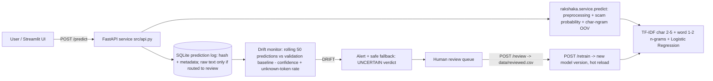

# Rakshaka AI

Rakshaka AI detects scam messages submitted in English, Sinhala, Singlish, Tamil, and Tanglish
(Sinhala/Tamil written with Latin characters). The supplied CSVs are English-only,
so this workflow preserves them and creates a balanced, human-review translation
sample. It does not generate translations automatically.

## Data workflow

1. Install dependencies: `python -m pip install -r requirements.txt`.
2. Place the two source datasets at `spam.csv` and
   `SMS PHISHING DATASET FOR MACHINE LEARNING AND PATTERN RECOGNITION/Dataset_5971.csv`.
   They are not included in this repository because redistribution rights were
   not established.
3. Clean and combine both source datasets:
   `python scripts/prepare_data.py`.
   This standardizes `ham` as `legitimate` and `spam`/`smishing` as `scam`,
   removes exact text duplicates, retains original labels and source row
   references, and fails if the same message has conflicting labels.
4. Review `data/annotation/translation_sample.csv` with native Sinhala
   speakers. Fill the Sinhala, Singlish, Tamil and Tanglish text independently, and set each
   language's status to `verified` only after a human reviewer confirms that
   the translation preserves the message's meaning and scam/legitimate label.
   Enter the reviewer's name or identifier. The initial sample contains up to
   100 unique messages per label; change `--sample-per-label` to adjust it.
5. Train and evaluate:
   `python scripts/train_model.py`.
   Only verified translations are used. All language variants sharing an
   original message are assigned to one train/validation/test split. The
   training groups are balanced by downsampling the majority class; validation
   and test sets retain their natural class distributions. Overall and
   per-language metrics are written to `artifacts/metrics.json`; a language
   with only one label in a split is marked not evaluable rather than assigned
   a misleading score.
6. Add newly observed and reviewed messages to
   `data/drift/drift_samples.csv` using its existing header, then run
   `python scripts/monitor_drift.py`. Its unseen character-ngram ratio is a
   text-shift signal, not a substitute for labeled accuracy evaluation. Alerts
   recommend human review and retraining; they never retrain automatically.
7. Run the local prediction API:
   `python scripts/serve.py`.
   `GET /health` reports service/model status. `POST /predict` accepts JSON
   such as `{"message":"...","language":"sinhala"}`; `language` can be
   `english`, `sinhala`, `singlish`, `tamil`, `tanglish`, or `unknown`. Predictions and drift events
   are written to `artifacts/predictions.jsonl`. Message contents are not
   written to prediction logs.

The classifier combines character and word TF-IDF features with logistic
regression. Character features can represent Sinhala/Tamil scripts and romanized text,
but performance in those languages is not established until reviewed examples
are supplied and the model is retrained. Language metadata is caller-provided;
the service does not pretend to distinguish English from romanized Sinhala
automatically.

## Streamlit app

The browser app is the place a person brings a message they already received,
from a phone text, an email, or anywhere else. Scoring starts when they press
**Check this message**. The app does not read a phone or an inbox.

```bash
python -m pip install -r requirements.txt
streamlit run app.py
```

Three screens:

- **Check a message.** The form asks where the message came from (phone text,
  email, or other), the language, and the message text. The result appears
  under the form after submit.
- **Drift watch.** Admins see a before/after comparison of cleaned messages
  against a shifted set, a chart of submitted checks, and the review inbox.
  The watch line is an unseen character-ngram ratio of 0.25. A shift recommends
  human review and retraining. The app never retrains by itself.
- **Who this protects.** A one-page impact note: who is protected, team
  estimates of reach and harm, and a pilot path. Edit `IMPACT_ESTIMATES` in
  `app.py` to replace the placeholder figures. They are labelled as team
  estimates on the page.

`artifacts/predictions.jsonl` records the time, model version, language,
source, prediction, scam probability, drift ratio, and latency. It does not
store the message text. `artifacts/review_queue.jsonl` stores the message text
only when the person presses **Send this to a reviewer**.

If `artifacts/model.joblib` is missing, the app still opens and says to train
first. Drift watch uses `data/processed/messages_clean.csv` and, when present,
`data/drift/drift_samples.csv`. Otherwise it uses the same built-in sample
shift as `scripts/demo_drift.py`. The prediction API is unchanged:
`python scripts/serve.py`.

## Monitoring and response

The API records timestamp, model version, declared language, prediction,
probability, latency, and a character-ngram drift signal without storing raw
messages. A drift threshold is a review trigger only; it is not a finding that
a message is malicious. Reviewers should verify new patterns and labels before
adding examples to training data or triggering retraining.
**Problem statement:** An ML service that flags scam SMS and WhatsApp messages in Sinhala, Tamil and Singlish, aimed at first-time mobile-banking users and pensioners in Sri Lanka. It detects and responds when new scam tactics (such as fake SL-UDI digital ID verification) make the model drift.

## Who it protects
<!-- TODO: first-time mobile-banking users, rural pensioners, Aswesuma welfare recipients -->

## Architecture




### Repository layout
| Path | What it is |
|---|---|
| `src/make_data.py` | Synthetic multilingual data generator: train / val / test / shifted, split by template |
| `src/train.py`, `src/evaluate.py` | Training (+ drift baselines from `val.csv`) and held-out evaluation, writes `reports/metrics.json` |
| `src/api.py`, `src/features.py` | FastAPI service: prediction, logging, drift monitor, review queue, retrain trigger |
| `app/dashboard.py` | Streamlit UI: check a message, monitoring and drift demo, human review + retrain |
| `rakshaka/` | Shared library: text cleaning, label handling, preprocessing, classifier, group splits, per-language metrics, char-ngram OOV signal, `predict()` |
| `scripts/` | Optional pipeline for the public English SMS datasets and human-verified translations (see below) |
| `tests/` | Unit tests (`python -m unittest discover -s tests`) |

## How to run
```bash
docker compose up --build        # API: http://localhost:8000/docs   UI: http://localhost:8501
```
or, without Docker (Python 3.12):
```bash
pip install -r requirements.txt
python src/make_data.py && cd src && python train.py && python evaluate.py
uvicorn api:app --port 8000                  # from src/
streamlit run app/dashboard.py               # from the repo root, in a second terminal
```
`./run.sh` does the same in one go. On Windows the dashboard calls the API on `127.0.0.1`, not `localhost`.
Using `localhost` adds about 2 s per request because of the IPv6 fallback.

API endpoints: `GET /health`, `POST /predict` (`{"text": "...", "language": "sinhala"}`; `language` is one of
`english`, `sinhala`, `singlish`, `tamil`, `tanglish`, `unknown`), `GET /monitor`, `GET /alerts`,
`GET /review_queue`, `POST /review`, `POST /retrain`.

## Data sources
| Source | Licence / method | Used for |
|---|---|---|
| `src/make_data.py` templates | Synthetic, hand-written by the team with AI assistance (Claude). All names, numbers and links are fake placeholders (`DemoBank`, `07X-XXXXXXX`, `*.example`) | train / val / test / shifted |
| `data/extra_train.csv` | Synthetic, 188 hand-curated messages written with Claude Code (Claude Opus 5.5) and reviewed by the team: Sinhala, Tamil, Singlish and Tanglish, about 23-24 scam and 23-24 legitimate per language. Fake placeholders only (`DemoBank`, `TestPay`, `07X-XXXXXXX`, `*.example`). The wording avoids the held-out test/val templates and their translations, and the shifted-set tactics | train |
| `data/extra_test.csv` (optional) | <!-- TODO: LLM-generated (model + prompt in data/PROMPTS.md) --> | test |
| `data/reviewed.csv` (runtime) | Labels entered by human reviewers in the dashboard | retraining |
| UCI SMS Spam Collection, Mendeley SMS Phishing Dataset (optional, not redistributed) | <!-- TODO: confirm licence --> | `scripts/` pipeline only |

No real personal data, phone numbers, NIC numbers or screenshots are used, in line with the PDPA No. 9 of 2022.
Demo messages that mention real programmes or services (Aswesuma, SL-UDI, eZ Cash) are clearly labelled synthetic examples.

The data is split **by template**: every message generated from one template lands in exactly one split,
so test scores measure generalisation to unseen wording instead of memorised templates. The split is
stratified by (label, language) with seed 42.
- **Train** (`data/train.csv`): 1,177 rows from 46 templates.
- **Validation** (`data/val.csv`): 276 rows from 10 unseen templates. Used only to measure the drift-monitor baseline.
- **Held-out test set** (`data/test.csv`): 264 rows from 12 unseen templates, covering the same tactics as training.
- **Shifted set** (`data/shifted.csv`): 152 rows from 15 templates with **new tactics**: SL-UDI digital ID / QR
  scams, biometric "re-verification" fees, USDT/AI crypto groups, "new number" impersonation, voice-note lures and
  heavier code-mixing.

## Evaluation (model v1, from `reports/metrics.json`)
| Set | Rows | Balanced acc. | Macro F1 | F1 (scam) | Mean confidence | Unknown-token rate |
|---|---|---|---|---|---|---|
| validation baseline | 276 | | | | 0.791 | 23.5% |
| **test** (unseen templates) | 264 | 0.899 | 0.925 | 0.962 | 0.823 | 18.5% |
| shifted (new tactics) | 152 | 0.950 | 0.970 | 0.993 | 0.828 | **50.4%** |

Test confusion matrix (rows = actual legitimate/scam, columns = predicted): `[[59, 15], [0, 190]]`.
No scam was missed. 15 legitimate messages were flagged as scam.

Per language on test (balanced accuracy): English 1.00, Singlish 1.00, Tamil 1.00, **Sinhala 0.50**. The
held-out Sinhala legitimate templates are all classified as scam. Sinhala legitimate data is the weakest
area and the first target for more data (`data/PROMPTS.md`). These scores come from a small synthetic
template set and are not a claim about real-world traffic.

## Monitoring and drift response
- **Prediction logging:** every prediction goes to `logs/predictions.db` with a timestamp, text hash, language,
  label, confidence, unknown-token rate, char-ngram OOV ratio, model version and routing. Operational logs go to
  `logs/service.log`. **Privacy:** raw message text is stored **only** for messages routed to human review,
  because a reviewer has to read them. Auto-handled messages keep only a hash.
- **Drift signal:** a rolling window of the last 50 predictions (judged after 20) is compared with baselines
  measured on the validation templates:
  - mean confidence drops by more than 0.10, or
  - the unknown-token rate (share of words never seen in training) rises more than 15 points.
- **Response:** a `DRIFT` alert is logged once per episode (`/alerts`, dashboard banner). Verdicts switch to
  "UNCERTAIN - be careful, sent for review", a safe fallback that never says "safe". Messages go to the
  **human review queue**, where a reviewer labels them (`POST /review` → `data/reviewed.csv`) and triggers
  **`/retrain`**. That creates a new model version and hot-reloads it. Individual messages also go to review when
  confidence is below 0.60 (about 3% of normal traffic) or when 50% or more of their words are unseen.

**Measured drift demo** (`uvicorn` + 50 messages per step, as in the dashboard's "Simulate traffic"):

| Step | Status | Mean conf. | Unknown-token rate | Sent to review |
|---|---|---|---|---|
| 50 test messages | OK | 0.817 | 16.5% | 3 |
| 50 shifted messages | **DRIFT** ("unknown-token rate 23% -> 50%") | 0.828 | 50.3% | 25 |
| review 28 queued messages → `/retrain` → v2 | | | | |
| 50 shifted messages | OK | 0.825 | 11.8% | 0 |
| 50 test messages | OK | 0.834 | 18.3% | 2 |

The drift signal fires on input shift **while accuracy is still high** (shifted F1 0.99). That is the point:
the product notices new scam tactics before it quietly starts failing. The post-retrain shifted batch shares
templates with the reviewed messages, so it shows that the loop works, not unseen-tactic accuracy.

`python scripts/demo_drift.py --model models/model.joblib --baseline data/test.csv --shifted data/shifted.csv`
gives an offline char-ngram OOV comparison on the same model: mean unseen char-ngram ratio 0.28 on test vs
0.41 on shifted. Its fixed per-message threshold of 0.25 also flags 124 of 200 normal test messages, so the
API's main drift signal is the calibrated window comparison above. The char-ngram ratio is logged as a
secondary signal.

## Optional: public English datasets and human-verified translations (`scripts/`)
The `scripts/` pipeline trains the same classifier from the two public English SMS datasets plus
**human-verified** Sinhala, Singlish, Tamil and Tanglish translations. It writes `artifacts/` and is
separate from the main demo.

1. Place the datasets at `spam.csv` and
   `SMS PHISHING DATASET FOR MACHINE LEARNING AND PATTERN RECOGNITION/Dataset_5971.csv`. They are not
   included in this repository because redistribution rights were not established.
2. `python scripts/prepare_data.py` maps `ham` to `legitimate` and `spam`/`smishing` to `scam`, removes exact
   duplicates, keeps the original labels and source row references, and fails on conflicting labels. Existing
   reviewed annotations are preserved when it runs again.
3. Native speakers fill `data/annotation/translation_sample.csv` (Sinhala, Singlish, Tamil, Tanglish columns)
   and set each language's status to `verified` with a reviewer identifier. **The code never translates
   automatically.** Only verified rows are used.
4. `python scripts/train_model.py` splits by original message group, so all language variants of one message
   share a split. It balances training groups and writes overall and per-language metrics to
   `artifacts/metrics.json`. A language with only one label in a split is marked not evaluable.
5. `python scripts/monitor_drift.py` and `python scripts/demo_drift.py` report unseen char-ngram ratios. They
   recommend human review and retraining but never retrain automatically.
6. `python scripts/serve.py` is the original standard-library HTTP server (legacy). The FastAPI service in `src/api.py`
   uses the same `rakshaka.service.predict()` and is the supported entry point.

## Validation
`python -m unittest discover -s tests` runs 13 unit tests. CI (`.github/workflows/tests.yml`) runs the tests,
the full data → train → evaluate pipeline and a container build.

## Impact statement
See [IMPACT.md](IMPACT.md).

## AI tools used
- Claude (Anthropic) generated the initial project scaffold (`src/`, `app/`, Docker files), which the team declares as a reused template.
- Claude Code (Claude Opus 5.5) helped merge the scaffold with the team's `rakshaka/` pipeline, fix bugs,
  write extra synthetic templates and calibrate the drift thresholds. Every change was reviewed by the team.
- <!-- TODO: list any others, e.g. the LLM used for synthetic data -->

## Licence
MIT (see [LICENSE](LICENSE)).
